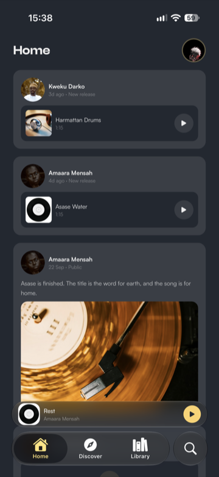
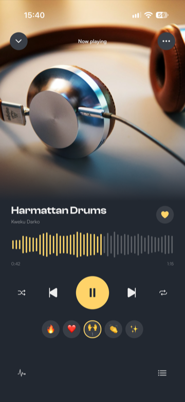
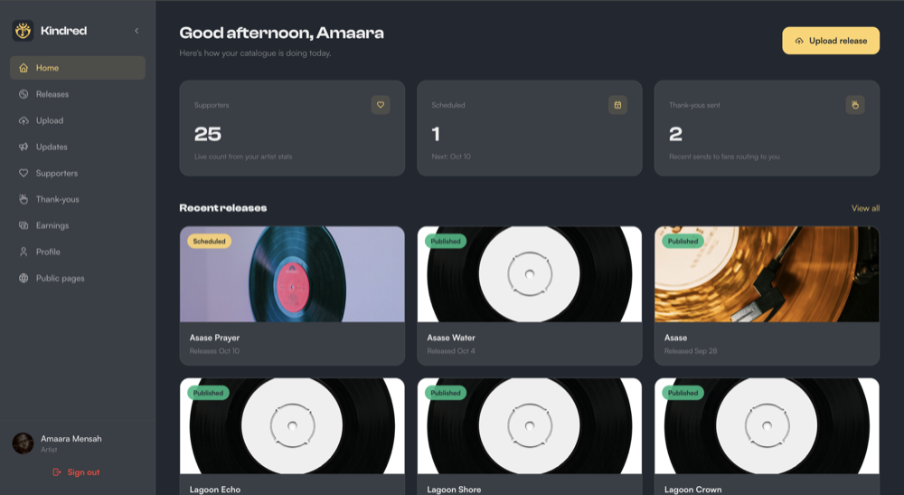
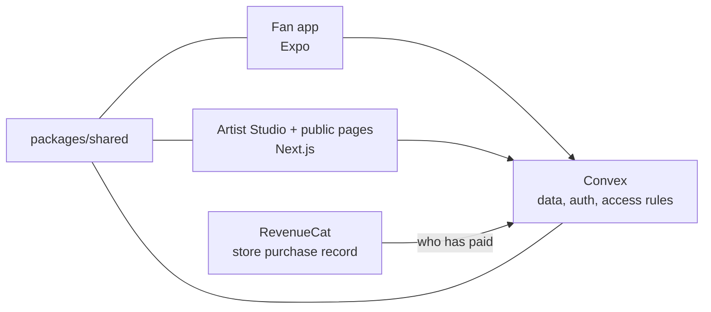

# Kindred

Patronage app for rising African artists. Fans support artists with a monthly subscription routed to the artists they choose. Artists release music from a web studio.

<p>
  
  
</p>


Walkthrough video and write-up: [dmstudiosgh.com/work/kindred](https://www.dmstudiosgh.com/work/kindred)

## Stack

- **Mobile:** Expo (React Native) — primary fan and supporter surface
- **Web:** Next.js — Artist Studio, public pages (simple public player), thin admin
- **Backend:** Convex with Convex Auth (email and password)
- **Payments:** RevenueCat (store purchases run in practice mode)
- **Shared:** `packages/shared` for types, validation, and utilities

## How it fits together



## Engineering decisions

- **The backend decides who may hear a track, not the phone.** Supporter status comes from the store's own record via RevenueCat, and Convex checks it before it sends an exclusive track. Reinstalling and tapping restore brings access back. *Gave up:* a simpler client-only check. Every exclusive play now depends on backend logic that has to be right.
- **Waveforms are measured once, at upload.** The peaks are saved on the track row, so the phone never analyses a song to draw its waveform. *Gave up:* upload does extra work and the peaks take database space (about 4 MB for the seed catalog).
- **The seed catalog is short clips, not full tracks.** Forty tracks, trimmed to about 75 seconds at 96 kbps, keep the demo inside Convex's free file-storage and egress limits. *Gave up:* audio quality and track length in the demo.

## Setup

1. From this folder: `yarn install`
2. Start Convex: `yarn dev:backend`
3. Web: `yarn dev:web`
4. Mobile: `yarn dev:mobile`

Convex Auth keys are set once per deployment: [docs/convex-auth-env.md](./docs/convex-auth-env.md).

## Commands

```bash
yarn lint
yarn type-check
yarn test:ci    # Convex tests, then app and shared tests
```

Product requirements: [docs/product/product-requirements.md](./docs/product/product-requirements.md).

Read [STATUS.md](./STATUS.md) for phase and next action.

## Credits

Seed music: tracks by [Kevin MacLeod](https://incompetech.com), licensed [CC BY 4.0](https://creativecommons.org/licenses/by/4.0/). Per-track credits are in [`seed/RIGHTS.md`](./seed/RIGHTS.md). Seed photos are from Unsplash and listed in `seed/image-sources.json`.
